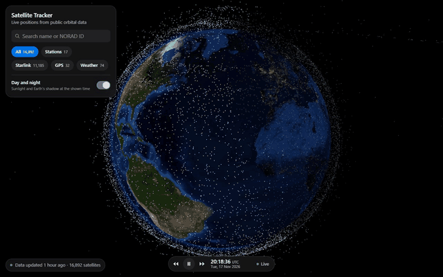
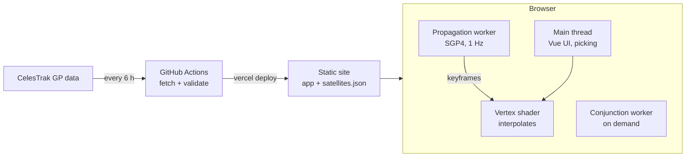

# Satellite Tracker

[](https://github.com/PathNotFound404/Satellite-Opus-Tracker/actions/workflows/ci.yml)

Every active satellite, about 17,000 of them, moving in real time on an interactive 3D globe. Orbital data comes from CelesTrak, and every position is computed in your browser with SGP4. No backend, no paid services.

**Live site:** _coming soon_ <!-- Replace with the Vercel production URL once the project is connected. -->



## What you can do

- **Watch the whole catalogue live.** 16,892 satellites (CelesTrak `active`, November 2026) at 60 fps, in one draw call.
- **Click a satellite** to see its altitude, speed, inclination, period and element-set age. Its orbit appears in blue and its ground track in white: the last orbit dim, the next one bright.
- **Search** by name or NORAD ID (try "ISS"). The camera flies to the result.
- **Filter** to stations, Starlink, GPS or weather satellites.
- **Control time:** pause, rewind, or run up to 1000x. Space pauses, `[` and `]` change the rate, and **Now** returns to real time.
- **Day and night:** the Earth is lit from the Sun's position at the shown time, with city lights on the night side. Satellites in Earth's shadow are dimmed.
- **Passes over you:** when the selected satellite crosses your sky in the next 24 hours, which passes you can see with the naked eye, and a jump straight to any of them. Your location never leaves your browser.
- **Close approaches:** screen the whole catalogue for anything passing within 10 km of the selected satellite in the next 24 hours.

Add `?debug` to the URL for frame timing and propagation stats.

## How it works



1. **Data pipeline.** A scheduled GitHub Actions workflow downloads CelesTrak's GP data (OMM JSON) every 6 hours, checks it against a [data contract](docs/data-contract.md) and deploys it as one static file with the Vercel CLI. The browser never calls CelesTrak. The workflow follows CelesTrak's fair-use rules: one download per update, stop at the first error. A failed run never replaces good data. Data is deployed, not committed ([ADR 0001](docs/adr/0001-deploy-data-with-vercel-cli.md)).
2. **Orbit math.** [satellite.js](https://github.com/shashwatak/satellite-js) runs SGP4 in a Web Worker for every satellite once a second. Positions come out in the TEME frame and are rotated into Earth-fixed coordinates by Greenwich sidereal time.
3. **Rendering.** All satellites are a single three.js `Points` object. The vertex shader blends the two most recent keyframes, so the main thread does one uniform write per frame for 17,000 moving points. Over one second the interpolation error is about 1 m ([ADR 0002](docs/adr/0002-propagation-strategy.md)).
4. **Everything else** (picking, pass prediction, ground tracks, lighting) is plain TypeScript in `src/orbital/`, separate from Vue and three.js and unit-tested.

## Accuracy and validation

SGP4 with public GP data is good to about a kilometre near the element-set epoch, and gets worse over days. The UI never shows more than 0.1 km of precision, shows each element set's age, and labels the close-approach feature as approximate.

The orbital code is tested against published and independent references, not just against itself:

| What | Reference | Agreement |
|---|---|---|
| SGP4 propagation | Vallado's SGP4-VER verification vectors | < 10 m |
| TEME → Earth-fixed | Vallado (2006) worked example | < 2 m |
| ISS position, Earth-fixed | Python [skyfield](https://rhodesmill.org/skyfield/) | < 1 km |
| Sun position (day/night) | skyfield + JPL DE421 ephemeris | < 0.5° |
| Ground track subpoints | skyfield WGS84 | < 0.01° |
| ISS passes over New York, 24 h | skyfield `find_events` | rise/peak/set < 10 s, peak elevation < 0.2° |
| Close-approach screening | Python sgp4 brute force, every second, full catalogue | 21/21 and 32/32 events found |

## Performance

Measured in Edge on a desktop with a GTX 1050 Ti, full catalogue:

- **60 fps** steady (p95 frame 16.8 ms), including at 1000x and with day/night shading.
- No per-frame allocations in app code (checked with the heap profiler).
- Click picking about 1 ms, search about 1 ms per keystroke, a 24 h pass search about 4 ms.
- Lighthouse, desktop: performance 89, accessibility 100, best practices 100, SEO 100.

On Lighthouse's mobile profile (slow 4G, 4× CPU slowdown) performance is about 50. Phones get 2K textures instead of 4K. What remains is the 1 MB (gzipped) satellite file and three.js start-up, the cost of showing the whole catalogue.

## Tech stack

| Layer | Choice |
|---|---|
| Front end | Vue 3 (`<script setup>`), Vite, TypeScript (strict) |
| 3D | three.js, custom GLSL shaders |
| Orbit math | satellite.js (SGP4), plus our own frames, geodesy, sun, passes and screening |
| Tests | Vitest (111 tests) |
| CI/CD | GitHub Actions (checks on every PR, scheduled data refresh), Vercel |
| Data | CelesTrak GP (OMM JSON) |

## Run locally

Requires Node 24 (see `.nvmrc`).

```sh
npm ci
npm run dev
```

Without a live data file, the app uses the committed 48-satellite `public/data/sample.json`.

| Task | Command |
|---|---|
| Dev server | `npm run dev` |
| Build | `npm run build` |
| Unit tests | `npm test` |
| Type check | `npm run typecheck` |
| Lint | `npm run lint` |
| Fetch real data | `npm run fetch-data` (counts against CelesTrak's per-IP limit; don't run it repeatedly) |

## Project layout

```
src/
  orbital/     pure TypeScript: SGP4 wrapper, frames, geodesy, sun, passes,
               ground track, close-approach screening (+ tests)
  three/       scene, globe, point cloud, keyframe timeline, picking, overlays
  workers/     propagation worker, conjunction worker
  composables/ Vue state: data, selection, filters, time, passes, lighting
  components/  panels and controls
scripts/       data fetch, validation and build-time data pull
docs/          brief, roadmap, architecture, data contract, CI/CD, ADRs
```

## Docs

[Project brief](docs/project-brief.md) · [Roadmap](docs/roadmap.md) · [Architecture](docs/architecture.md) · [Data contract](docs/data-contract.md) · [CI/CD](docs/ci-cd.md) · [ADRs](docs/adr/)

## Credits

- **Orbital data:** [CelesTrak](https://celestrak.org/) (Dr. T.S. Kelso), GP element sets.
- **Earth imagery:** NASA Blue Marble and NASA night imagery (public domain). See [public/textures/ATTRIBUTION.md](public/textures/ATTRIBUTION.md).
- **Libraries:** [satellite.js](https://github.com/shashwatak/satellite-js), [three.js](https://threejs.org/), [Vue](https://vuejs.org/).
- **Validation only** (not shipped): [skyfield](https://rhodesmill.org/skyfield/) and [sgp4](https://pypi.org/project/sgp4/) by Brandon Rhodes.
