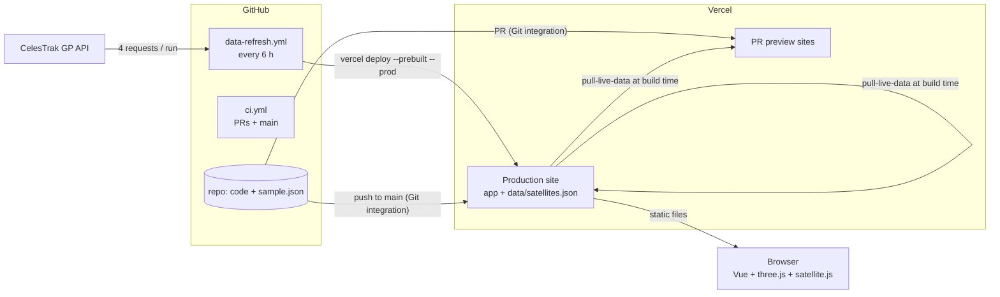

# Architecture

A static web app. A scheduled GitHub Actions workflow fetches orbital data from CelesTrak and deploys it as a static JSON file to Vercel. The browser loads that file once, runs SGP4 (satellite.js) locally and renders every satellite in a single three.js points object. There is no backend.

Related docs: [project brief](project-brief.md), [roadmap](roadmap.md), [CI/CD plan](ci-cd.md), [data contract](data-contract.md), [ADRs](adr/).

## System overview



Key points:

- **Only `data-refresh.yml` ever talks to CelesTrak.** Neither the browser nor Vercel builds call it.
- **Data is deployed, not committed.** See [ADR 0001](adr/0001-deploy-data-with-vercel-cli.md). The repo only holds a small `sample.json`.
- **Every build gets data the same way:** if `public/data/satellites.json` doesn't exist yet, `scripts/pull-live-data` downloads it from the production site, falling back to `sample.json`. The data-refresh workflow writes the fresh file first, so the pull step skips.
- **The last good file is always the one live.** If a fetch or validation fails, the workflow does not deploy, so production keeps serving the previous data.

## Two deploy paths

| Trigger | Who builds | Data used | Deploy |
|---|---|---|---|
| Push to `main` | Vercel (Git integration) | Current production data via `pull-live-data` | Production |
| Pull request | Vercel (Git integration) | Current production data via `pull-live-data` | Preview URL |
| Schedule (every 6 h) or manual | GitHub Actions + Vercel CLI | Freshly fetched and validated data | Production |

Both paths produce the same build output. The only difference is where `satellites.json` comes from.

## Front-end structure

```
src/
  types/        data contract types (SatelliteFile, OmmRecord, ...)
  orbital/      pure TS: satrec creation, propagation, TEME->ECF, altitude,
                speed, look angles, pass prediction. No Vue, no three.js.
  three/        scene, camera, controls, globe, point cloud, orbit line,
                picking, unit conversion (km -> scene units)
  composables/  useSatellites (load + index data), useSelection,
                useSimClock, useFilters
  components/   InfoPanel, SearchBox, GroupFilter, DataAgeBadge, ...
  App.vue
  main.ts
```

### Layer rules

- `orbital/` depends only on `satellite.js` and `types/`. Easy to unit test.
- `three/` depends on `orbital/` and `types/`. It never imports Vue.
- `composables/` and `components/` glue it together. three.js objects are created outside Vue reactivity (module-level variables or `markRaw`), and only small values (selected ID, filter state, panel numbers) are reactive.

## Data flow at runtime

1. **Load:** `useSatellites` fetches `/data/satellites.json` once, checks `schemaVersion`, and builds `satrec`s from the OMM records. Records that fail to parse are dropped and counted.
2. **Index:** keep satellites in plain arrays indexed by a stable position `i`. That index is shared by the satrec array, the position buffer, the filter mask and picking. Groups are resolved to index sets once.
3. **Clock:** `useSimClock` is the single source of simulation time (real time at 1x until time controls land).
4. **Propagate:** for each satellite, `propagate(satrec, simTime)` → TEME position (km) → ECF via GMST → scene units → written into the shared `Float32Array`. Failures hide that point (see below).
5. **Render:** one `THREE.Points` with a `BufferGeometry` whose position attribute uses that array. Set `needsUpdate` once per update.
6. **Select:** a click is raycast against the points; the hit index maps back to the satellite. The info panel reads altitude, speed and inclination from `orbital/` helpers for that one satellite.

## Frames, units and constants

These rules exist because frame and unit bugs are silent.

| Concept | Rule |
|---|---|
| satellite.js output | TEME frame, km and km/s |
| Earth-fixed | `orbital/frames.ts` converts TEME→ECF with GMST (`satellite.gstime`). Single function, unit-tested. |
| Earth radius | One constant, `EARTH_RADIUS_KM = 6378.137` (WGS84 equatorial), in `orbital/constants.ts` |
| Altitude | `‖r‖ − EARTH_RADIUS_KM` (spherical approximation; accurate enough for display) |
| Speed | `‖v‖` in km/s |
| Scene units | 1 scene unit = 1 Earth radius. The only km→scene conversion lives in `three/units.ts`. |
| Axes | ECF has z toward the North Pole; three.js is y-up. Remap axes in the same `three/units.ts` function, and align the Earth texture to match (tested visually against a known ground position). |

Because positions are converted to ECF, the Earth mesh does not rotate with time; the satellites move relative to it.

## Propagation strategy (decided in M3)

The starting point is to propagate every satellite on the main thread, writing into a reused `Float32Array`. In M3 we measure frame time with the full catalog. If propagation costs too much of the 16.6 ms frame budget, the options in order of preference:

1. **Lower-rate propagation with interpolation:** propagate each satellite at, e.g., 1–4 Hz (spread across frames) and interpolate positions between samples.
2. **Web Worker:** move propagation to a worker, transferring a typed array each tick.

The result goes in `docs/adr/0002-propagation-strategy.md`.

## Invalid and decayed satellites

- satellite.js can return `false` or a position containing `NaN` for decayed or bad elements.
- Such satellites are marked invalid: their point is moved out of view (or masked in the shader), never left at the origin or the last good position.
- They're excluded from search results and counted in a debug readout.

## Picking

- `THREE.Raycaster` with a points threshold scaled to camera distance. This is O(n) per click, which is fine for 10k points on click events.
- Hover highlighting (if added) would need a cheaper method (throttling or GPU color-ID picking). Decide when needed.

## Accuracy and data age

- GP/SGP4 accuracy is on the order of a kilometer at epoch and degrades over days. The UI never shows more than 1 decimal place of km and never implies sub-kilometer accuracy.
- `DataAgeBadge` shows the age from `generatedAt`. Above 24 hours old it shows a warning (the pipeline is probably failing).
- Each record's own `EPOCH` can be older than `generatedAt`. The info panel shows the epoch.

## Performance rules

- One draw call for all satellites.
- No allocations in the render loop: preallocate vectors, typed arrays and the GMST/rotation scratch values.
- Filtering updates a mask (size attribute or alpha) instead of rebuilding geometry.
- Satellite data is not deep-reactive. Store arrays with `shallowRef` or outside Vue.